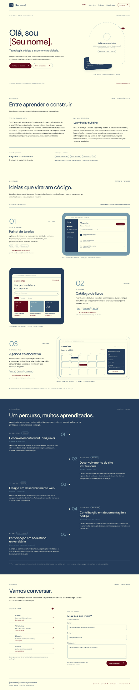
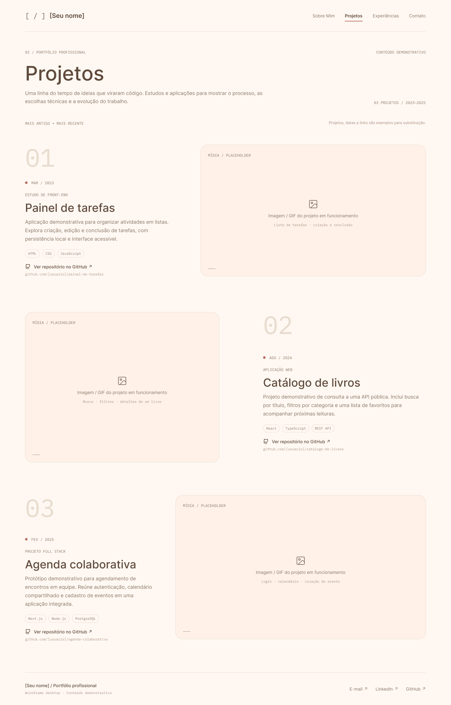
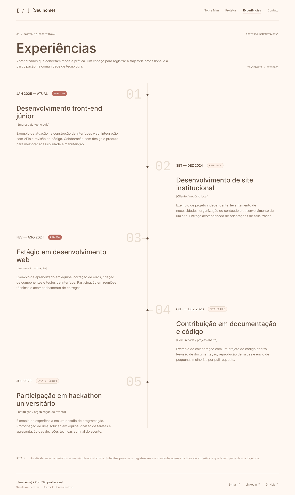
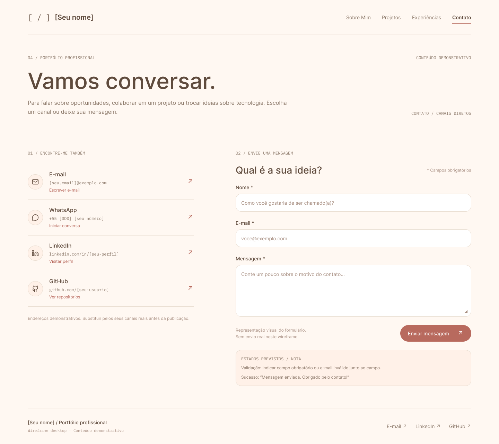

<div align="center">

# ✦ Portfólio Profissional — Letícia Abreu

**Tecnologia, código e experiências digitais.**

Portfólio pessoal desenvolvido para apresentar minha trajetória em Engenharia de Software, meus projetos acadêmicos, minhas habilidades e meu processo contínuo de aprendizagem.


[🌐 Acessar portfólio online](https://leticiaabreu.vercel.app/)  
[Repositório no GitHub](https://github.com/xabreuleticia/portfolio-profissional)

</div>

---

## 📚 Índice

- [Sobre o Projeto](#-sobre-o-projeto)
- [Funcionalidades Principais](#-funcionalidades-principais)
- [Tecnologias Utilizadas](#-tecnologias-utilizadas)
- [Arquitetura](#-arquitetura)
- [Instalação e Execução](#-instalação-e-execução)
- [Variáveis de Ambiente](#-variáveis-de-ambiente)
- [Estrutura de Pastas](#-estrutura-de-pastas)
- [Demonstração](#-demonstração)
- [Verificações](#-verificações)
- [Documentações Utilizadas](#-documentações-utilizadas)
- [Autoria](#-autoria)
- [Contribuição](#-contribuição)
- [Licença](#-licença)

---

## 📝 Sobre o Projeto

Este projeto é meu portfólio profissional, criado para reunir em um único espaço minha trajetória como estudante de Engenharia de Software e os conhecimentos que venho desenvolvendo na área de tecnologia.

O site apresenta projetos acadêmicos e pessoais, experiências, habilidades técnicas e informações de contato. A proposta é mostrar não apenas os resultados dos projetos, mas também meu processo de aprendizagem, minha curiosidade e minha evolução na prática da programação.

A interface utiliza uma identidade visual própria, com uma paleta baseada em tons de vinho, azul, azul-acinzentado, grafite e creme. O site também oferece navegação em português e inglês.

## ✨ Funcionalidades Principais

- 🌐 **Interface bilíngue:** alternância entre português e inglês.
- 🏠 **Página inicial:** apresentação pessoal e acesso às principais áreas do portfólio.
- 👩‍💻 **Sobre mim:** informações sobre minha trajetória e meus interesses.
- 📂 **Projetos:** apresentação de projetos com descrições e tecnologias utilizadas, incluindo HydroFix, Cobrinha.zip e Delíciare.
- 🧭 **Experiências:** seção dedicada às experiências e atividades relevantes para minha formação.
- 🧩 **Habilidades interativas:** apresentação de tecnologias e ferramentas que estudo e utilizo nos projetos.
- 📖 **Mapa pessoal em formato de álbum:** experiências e fotografias organizadas por destinos, com legendas e informações associadas às imagens.
- ⏱️ **Estatísticas de programação:** integração com o WakaTime para exibir informações de atividade de código.
- ✉️ **Formulário de contato:** integração com o EmailJS para envio de mensagens por e-mail.
- 📄 **Currículo:** acesso ao arquivo de currículo em PDF, quando disponibilizado no caminho esperado pelo projeto.
- 📱 **Layout responsivo:** adaptação da interface a diferentes tamanhos de tela.

## 🛠️ Tecnologias Utilizadas

### 💻 Front-end

- **React:** construção da interface por componentes.
- **JavaScript (ES6+):** lógica e comportamento da aplicação.
- **Vite:** ambiente de desenvolvimento e ferramenta de build.
- **Tailwind CSS v4 e CSS:** estilização e responsividade.
- **Lucide React e React Icons:** ícones da interface.
- **React Three Fiber e Drei:** recursos gráficos interativos em 3D na seção de habilidades.

### 🔌 Integrações

- **EmailJS:** envio de mensagens pelo formulário de contato.
- **WakaTime:** exibição de estatísticas relacionadas ao tempo de programação.

### ⚙️ Ferramentas de desenvolvimento

- **Node.js e npm:** execução dos scripts e gerenciamento de dependências.
- **ESLint:** análise estática e verificação de padrões do código.
- **Git e GitHub:** versionamento e hospedagem do repositório.

> As versões exatas das dependências podem ser consultadas no arquivo `package.json` do projeto.

## 🏗️ Arquitetura

O portfólio é uma aplicação front-end construída com React. A interface é organizada em seções e componentes, enquanto arquivos de contexto e módulos de dados ajudam a compartilhar configurações e manter o conteúdo separado da apresentação visual.

- **Componentes reutilizáveis:** elementos de navegação, rodapé, botões e títulos de seção.
- **Seções da página:** agrupam conteúdos como início, apresentação pessoal, projetos, experiências, habilidades, contato e estatísticas de programação.
- **Contexto de idioma:** centraliza o estado usado para alternar os textos entre português e inglês.
- **Módulos de dados:** armazenam informações de projetos, experiências e conteúdo do álbum pessoal.
- **Serviços externos:** EmailJS atende ao formulário de contato e o WakaTime fornece informações de atividade de programação.
- **Arquivos estáticos:** imagens, documentos e outros recursos visuais são carregados a partir das pastas públicas ou de assets do projeto.

O fluxo geral pode ser representado assim:

```text
Usuário
  ↓
Interface React (Vite)
  ├── Componentes reutilizáveis
  ├── Seções do portfólio
  ├── Contexto de idioma
  ├── Dados dos projetos e do álbum
  └── Integrações externas
       ├── EmailJS (contato)
       └── WakaTime (estatísticas)
```

## 🔧 Instalação e Execução

### Pré-requisitos

- **Node.js** em uma versão compatível com o projeto.
- **npm**, instalado junto com o Node.js.
- **Git**, para clonar o repositório.

### 1. Clone o repositório

```bash
git clone https://github.com/xabreuleticia/portfolio-profissional.git
cd portfolio-profissional
```

### 2. Instale as dependências

```bash
npm install
```

### 3. Configure as variáveis de ambiente

Crie o arquivo `.env.local` na raiz do projeto e configure as variáveis usadas pela integração do EmailJS. Consulte a seção [Variáveis de Ambiente](#-variáveis-de-ambiente).

### 4. Inicie o ambiente de desenvolvimento

```bash
npm run dev
```

O Vite exibirá no terminal o endereço local para abrir o portfólio no navegador — normalmente `http://localhost:5173`.

### 5. Gere a versão de produção

```bash
npm run build
```

Os arquivos gerados para publicação ficam na pasta `dist/`.

Para visualizar localmente a versão compilada, utilize:

```bash
npm run preview
```

## 🔑 Variáveis de Ambiente

O formulário de contato utiliza configurações do EmailJS. No arquivo `.env.local`, adicione as variáveis abaixo com os valores correspondentes à sua própria conta e aos templates configurados no EmailJS:

```dotenv
VITE_EMAILJS_SERVICE_ID=seu_service_id
VITE_EMAILJS_TEMPLATE_ID_FOR_ME=seu_template_id_para_voce
VITE_EMAILJS_TEMPLATE_ID_FOR_SENDER=seu_template_id_de_confirmacao
VITE_EMAILJS_PUBLIC_KEY=sua_public_key
VITE_CONTACT_EMAIL=seu_email_de_contato
```

`VITE_CONTACT_EMAIL` é opcional caso a implementação atual do projeto não o utilize como configuração obrigatória.

**Importante:** não envie o arquivo `.env.local` para o GitHub. Confira se ele está coberto pelo `.gitignore` antes de realizar um commit. Variáveis com prefixo `VITE_` podem ficar acessíveis no código executado no navegador; não coloque nelas senhas ou chaves privadas de serviços. Para o WakaTime, siga os requisitos da implementação presente no código e não publique credenciais privadas.

## 📂 Estrutura de Pastas

Principais diretórios e arquivos do projeto:

```text
portfolio-profissional/
├── public/
│   ├── documentos/             # Arquivos públicos, como o currículo em PDF
│   └── images/                 # Imagens acessadas por caminho público
├── src/
│   ├── assets/
│   │   └── mapa-pessoal/       # Fotografias organizadas por destino/álbum
│   ├── components/             # Componentes reutilizáveis da interface
│   ├── config/
│   │   └── emailJsConfig.js    # Configuração da integração com EmailJS
│   ├── context/
│   │   └── LanguageContext.jsx # Contexto para alternância de idioma
│   ├── data/
│   │   ├── projetos.js         # Conteúdo dos projetos
│   │   ├── experiencias.js     # Conteúdo das experiências
│   │   └── mapaPessoalData.js  # Dados e legendas do álbum pessoal
│   ├── sections/               # Seções principais do portfólio
│   ├── App.jsx                 # Composição principal da aplicação
│   └── index.css               # Estilos globais
├── .gitignore
├── package.json                # Dependências e scripts
├── package-lock.json           # Versões resolvidas pelo npm
└── README.md                   # Documentação do projeto
```

> A estrutura acima resume os principais caminhos conhecidos do projeto. Arquivos adicionais podem existir no repositório.

### 📄 Currículo em PDF

Se a seção de contato estiver configurada para esse caminho, coloque o arquivo de currículo em:

```text
public/documentos/curriculo-leticia.pdf
```

Use o nome de arquivo esperado pelo código para que os links de visualização e download funcionem.

## 🎥 Demonstração

### 🎨 Protótipos de interface — Desktop

Os protótipos abaixo apresentam a proposta visual do portfólio e de algumas de suas seções. Eles servem como referência de design; a interface final pode apresentar diferenças conforme a implementação evolui.

#### Visão geral do portfólio

<p align="center">
  
</p>

#### Protótipos por seção

<table>
  <tr>
    <th align="center">Projetos</th>
    <th align="center">Experiências</th>
    <th align="center">Contato</th>
  </tr>
  <tr>
    <td align="center"></td>
    <td align="center"></td>
    <td align="center"></td>
  </tr>
</table>

> **Observação:** as imagens são protótipos de interface em desktop, não necessariamente capturas da aplicação em execução.

**🌐 Portfólio publicado:** [Acesse o site](https://leticiaabreu.vercel.app/).  
Os protótipos acima representam a proposta visual inicial; para conhecer a versão implementada, acesse o site publicado. Você também pode adicionar capturas reais de tela nesta seção.

## 🧪 Verificações

Para analisar o código com o ESLint:

```bash
npm run lint
```

Para verificar se a aplicação gera o build de produção:

```bash
npm run build
```

A validação manual deve incluir a alternância de idioma, navegação entre as seções, responsividade, abertura dos links do currículo, carregamento das imagens, envio do formulário de contato e exibição das estatísticas do WakaTime.

## 🔗 Documentações Utilizadas

- [Documentação do React](https://react.dev/)
- [Documentação do Vite](https://vite.dev/)
- [Documentação do Tailwind CSS](https://tailwindcss.com/docs)
- [Documentação do EmailJS](https://www.emailjs.com/docs/)
- [WakaTime — documentação](https://wakatime.com/developers)
- [Documentação do ESLint](https://eslint.org/docs/latest/)
- [GitHub Docs](https://docs.github.com/)

## 👩‍💻 Autoria

**Letícia Abreu** — estudante de Engenharia de Software.

- **GitHub:** [@xabreuleticia](https://github.com/xabreuleticia)
- **Repositório:** [portfolio-profissional](https://github.com/xabreuleticia/portfolio-profissional)

## 🤝 Contribuição

Este projeto é um portfólio pessoal e acadêmico. Sugestões e apontamentos podem ser enviados por meio das issues do repositório.

Para propor alterações usando Git:

1. Faça um fork ou crie uma branch para a alteração.
2. Faça as mudanças e verifique o projeto com `npm run lint` e `npm run build`.
3. Registre as alterações em um commit.
4. Envie um pull request com uma descrição clara do que foi modificado.

## 📄 Licença

Até que uma licença seja adicionada ao repositório, não presuma que o código está liberado para reutilização, distribuição ou modificação. Para definir essas permissões, adicione um arquivo `LICENSE` com a licença escolhida.
